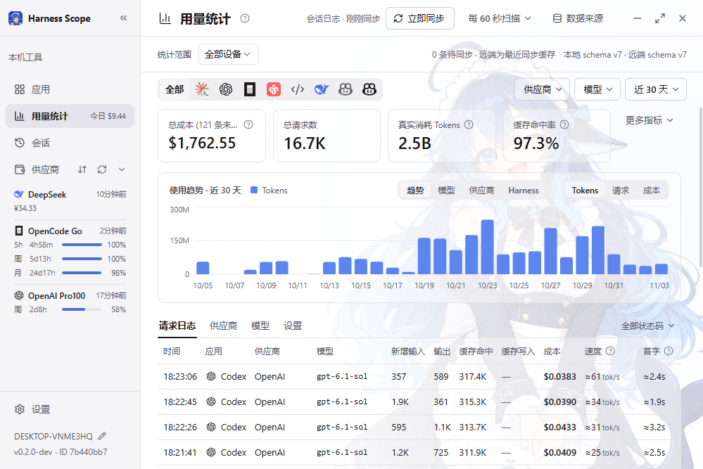
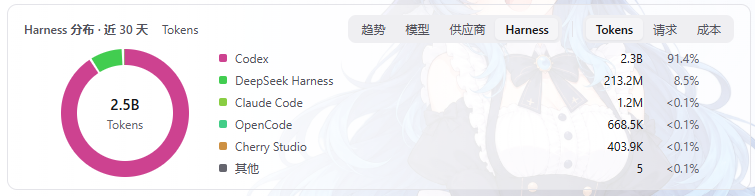
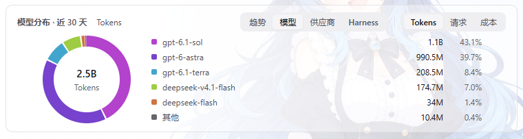
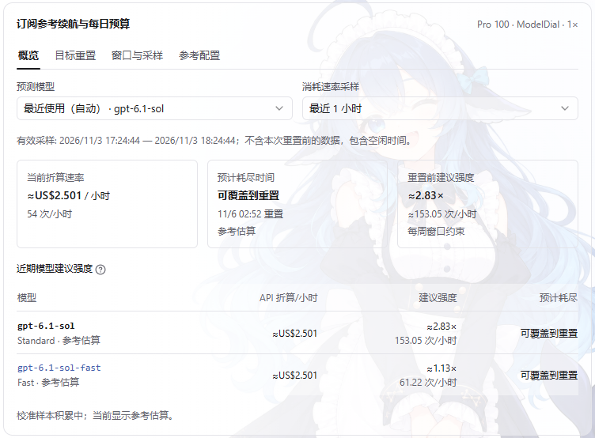

# Harness Scope

把不同 AI 编程工具的用量、会话和订阅额度放在一起看。

Harness Scope 是一个以本机数据为基础的桌面应用：从编程工具已有的日志或数据库采集使用记录，查看 Tokens、费用估算、模型表现和会话内容。需要跨设备汇总时，可以连接自己部署的同步服务器。

## 能做什么

- **汇总用量**：按工具、模型、供应商、设备和时间筛选，查看趋势、热力图、分布和逐请求明细。
- **浏览会话**：搜索本机会话，阅读对话与工具步骤，导出 Markdown，复制支持的恢复命令。
- **管理订阅**：查询 DeepSeek 余额、OpenCode Go 和 OpenAI／Codex 额度，记录套餐信息，查看历史变化与参考续航。
- **比较请求表现**：显示有依据的耗时、速度和首字估算，区分 Codex 的 Standard、Fast 和未知档位。
- **跨设备查看**：同步用量事实，以及明确关联到同一共享订阅的额度历史；离线时保留本机数据和待传队列。
- **接续旧统计**：预览并迁入 CC Switch schema v20 的历史用量，按分界日衔接原生日志。

## Screenshot

### 用量总览：从汇总追到每次请求

把不同 AI 编程工具与设备的用量放在同一个视图中，集中查看费用、请求数、Tokens 和缓存命中率。按时间、工具、供应商或模型筛选后，可以继续核对逐请求的输入输出、缓存、费用、生成速度与首字估算；连接自部署同步服务器后，还能汇总其他设备已同步的用量。



### 工具分布：看清用量花在哪个 Harness

将 Codex、DeepSeek Harness、Claude Code、OpenCode、Cherry Studio 等工具放在同一张分布图中，直接比较各自的用量与占比。支持切换 Tokens、请求数和成本，方便了解自己的工具使用习惯，以及主要消耗来自哪里。



### 模型分布：比较模型的实际使用占比

在相同时间范围内按模型汇总用量，对照各模型的总量与占比，也可以切换到请求数或成本视角。结合工具、供应商和设备筛选，查看不同场景下的模型使用构成。



### 订阅续航与每日预算：把剩余额度换成使用节奏

结合官方额度窗口、近期关联请求和参考配置，查看当前消耗速率、能否覆盖到重置，以及重置前的建议使用强度。Codex 预测可分别展示 Standard 与 Fast 档位，支持调整采样时长和目标重置时间，帮助安排接下来的使用节奏；结果受样本与参考规则影响，属于参考估算。



## 支持的工具

| 工具 | 数据来源 | 支持范围 |
| --- | --- | --- |
| Claude Code | JSONL 会话日志 | 用量、会话、请求计时估算 |
| Codex | JSONL 用量；JSONL／Zstandard 会话 | 用量、会话、分段与继承去重、请求档位 |
| OpenCode | V1／V2 SQLite | 用量、会话、原生费用、迁移副本去重 |
| DeepSeek Harness | v0／v4 JSONL、Zstandard | 用量、会话、缓存与推理细分、流式计时估算 |
| Cherry Studio | 2.x SQLite | 会话和可完整拆分的逐次用量；未知旧汇总不计入 |
| LM Studio | 0.4.x 桌面会话 JSON | 历史会话、全部生成版本和增量 Token；费用未计价，不采集服务器 API 日志 |
| GitHub Copilot（兼容导入） | VS Code chatSessions JSON／JSONL | 用户请求、会话和可确认的输出 Tokens；需先配置历史来源边界 |

Copilot 的完整 Credits／PRU 计量、Agent Host 和 CLI 导入仍未实现。各工具的格式限制和配置方法见[使用指南](docs/USAGE.md)及[兼容说明](docs/README.md#工具兼容与计量)。

## 开始使用

在 [GitHub Releases](https://github.com/InariAimu/harness-scope/releases) 下载 Windows x64、Linux x64 和 macOS 通用桌面程序；Linux 另提供同步服务端。各文件的依赖、签名状态和校验方法见对应版本的发布说明。自动更新尚未配置。

也可以从源码运行：

准备 Node.js 22.12+、Rust 和对应平台的 [Tauri 开发依赖](https://v2.tauri.app/start/prerequisites/)，在仓库根目录执行：

```powershell
npm ci
npm run desktop
```

启动后在「应用」页检查数据来源目录，在「用量」和「会话」页查看结果。供应商账号与多设备同步按需配置。

Windows 可执行文件的构建步骤见[开发与构建](docs/DEVELOPMENT.md)。自部署同步服务见[服务器说明](server/README.md)。

## 数据与边界

会话正文、项目路径和 API Key 不进入同步负载。供应商凭据保存在本机；官方余额查询、价表下载和同步请求使用应用的网络设置。

日志中的用量、模型参考费用、订阅额度估算和实际账单是不同口径。缺少价格或计时依据时显示未知；Copilot 兼容导入中的缺失 Token 有专门限制。不同设备上的同一份原生日志副本目前没有全局去重，应避免重复采集。

同步服务采用单用户共享令牌模型，不提供多人权限或远端会话正文浏览。Windows 桌面和 Linux 服务端有完整 CI 检查；三平台发布流程另做原生构建和启动检查，平台特有交互仍需单独验证。

## 文档

| 想了解什么 | 入口 |
| --- | --- |
| 来源目录、统计、会话、迁移与同步 | [使用指南](docs/USAGE.md) |
| 账号、额度预测、自定义查询和共享订阅 | [供应商与订阅](docs/PROVIDERS.md) |
| 本地开发、Windows 构建、版本管理 | [开发与构建](docs/DEVELOPMENT.md) |
| 模块职责、数据流与同步规则 | [架构与数据契约](docs/ARCHITECTURE.md) |
| 所有专题与验证方法 | [文档索引](docs/README.md) |

## 来源与许可

项目采用 [MIT 许可证](LICENSE)。界面、会话阅读器和部分统计组件参考或复用 CC Switch；原作者 Jason Young 的许可及具体来源见 [third_party/UPSTREAM.md](third_party/UPSTREAM.md) 和 [CC Switch 许可证](third_party/CC-Switch-LICENSE)。Cherry Studio 图标及其他素材的来源和各自许可另见来源清单。
